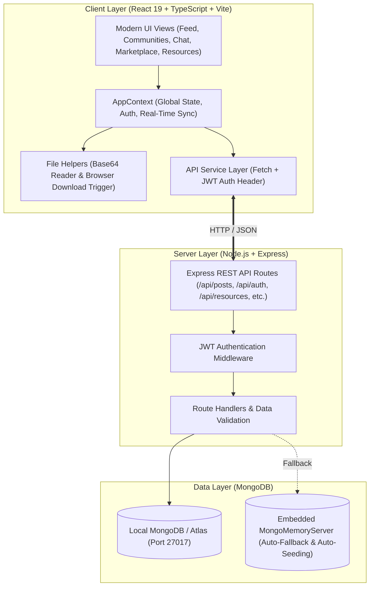

# 🎓 UniConnect — Campus Academic & Community Portal

<p align="center">
  
</p>

<p align="center">
  <strong>A unified, full-stack campus ecosystem connecting students, faculty, and student organizations.</strong><br>
  Built with React 19, TypeScript, Vite, Node.js, Express, and MongoDB.
</p>

<p align="center">
  <a href="#-key-features"></a>
  <a href="#-tech-stack"></a>
  <a href="#-tech-stack"></a>
  <a href="#-tech-stack"></a>
  <a href="#-tech-stack"></a>
  <a href="#-license"></a>
</p>

---

## 📌 Table of Contents

- [✨ Project Overview](#-project-overview)
- [🚀 Quick Start (1-Minute Run)](#-quick-start-1-minute-run)
- [🛠️ Tech Stack](#️-tech-stack)
- [🏛️ System Architecture](#️-system-architecture)
- [🎯 Complete 13 Feature Breakdown](#-complete-13-feature-breakdown)
- [👥 4-Member Work Contribution Matrix](#-4-member-work-contribution-matrix)
- [🔑 Seed Accounts & Demo Credentials](#-seed-accounts--demo-credentials)
- [📡 REST API Reference](#-rest-api-reference)
- [📂 Project Directory Structure](#-project-directory-structure)
- [🤝 Contributing & License](#-contributing--license)

---

## ✨ Project Overview

**UniConnect** is designed to eliminate fragmented campus communication. Instead of juggling separate tools for coursework notes, club announcements, direct messaging, secondhand textbooks, lost IDs, and event passes, UniConnect unifies everything into a single, responsive web portal.

### 💡 Highlights
- 📁 **Direct Device File Uploads**: Pick local PDFs, Word docs, and photos directly from your device with live previews.
- 💾 **Real Browser Downloads**: Immediate physical file downloads for study notes, syllabi, event passes, and academic CVs.
- 💬 **Dynamic Community & Seller Chats**: Joining a club or clicking "Contact Seller" instantly spins up a live chat channel.
- ⚡ **Zero-Config Database**: Embeds `mongodb-memory-server` out-of-the-box so the app runs with full data seeding even without a local MongoDB service.

---

## 🚀 Quick Start (1-Minute Run)

### 1. Clone & Install
```bash
# Clone the repository
git clone https://github.com/Naeem955-something/uiu_soical_media.git
cd uiu_soical_media

# Install frontend dependencies
npm install

# Install backend dependencies
cd server
npm install
cd ..
```

### 2. Run Both Servers

Open two terminals:

**Terminal 1 (Backend Server):**
```bash
cd server
npm start
```
*Backend starts on `http://localhost:5000` with auto-seeded MongoDB.*

**Terminal 2 (Frontend Client):**
```bash
npm run dev
```
*Frontend runs on `http://localhost:5173`.*

---

## 🛠️ Tech Stack

| Layer | Technologies & Libraries |
| :--- | :--- |
| **Frontend Framework** | **React 19** + **TypeScript** |
| **Build & Tooling** | **Vite 8** + ESBuild |
| **Icons & UI** | **Lucide React** + Custom CSS Variable Design System |
| **Backend Runtime** | **Node.js** + **Express.js** |
| **Database & ODM** | **MongoDB** + **Mongoose** + **mongodb-memory-server** |
| **Security & Auth** | **JWT (JSON Web Tokens)** + **bcryptjs** |
| **API Client** | Native Fetch API with auto-fallback to local state |

---

## 🏛️ System Architecture



---

## 🎯 Complete 13 Feature Breakdown

<details open>
<summary><strong>1. Campus Feed & Rich Interactive Posts</strong></summary>

- Share academic status updates, project collaborations, and announcements.
- Embed multiple choices for live campus polls with dynamic vote percentages.
- Attach downloadable PDFs, Word docs, and photos directly from your device.
- Full like toggle, nested comments, author identity tags, and post deletion for own posts.
</details>

<details>
<summary><strong>2. Academic Communities & Student Clubs Hub</strong></summary>

- Browse student-run societies (Machine Learning Club, Robotics Society, AI Research Lab).
- Category filtering (`Technology`, `Academic`, `Research`).
- **Auto-Group Chat**: Joining a community automatically generates a linked chat channel.
- Dedicated community discussion board with real photo and file attachments.
</details>

<details>
<summary><strong>3. Direct & Group Chat Channels</strong></summary>

- Real-time conversation threads with typing indicators and seen receipts.
- Direct messages (1-on-1) and group project channels.
- Send documents and images via direct device file picker.
- Clickable download button on attachments with browser file delivery.
</details>

<details>
<summary><strong>4. Academic Resource Sharing Library</strong></summary>

- Digital repository for Course Cheat Sheets, Lecture Notes, Exam Prep, and Code Templates.
- Direct upload modal: auto-detects file format (`PDF`, `DOCX`, `ZIP`, `PPTX`) and calculates file size.
- 1-Click download triggers real browser download to user's computer.
- Search and filter by Course Code (e.g. `CS-402`, `SE-301`) and rating sort.
</details>

<details>
<summary><strong>5. Campus Peer-to-Peer Marketplace</strong></summary>

- Student marketplace for textbooks, electronics, dorm furniture, and calculators.
- Filter by category, campus location (North Campus, South Hostel, Science Block), price range, and condition.
- "Sell an Item" modal with local device photo upload and live preview.
- **Dynamic Contact Seller**: 1-click opens an active direct chat channel with the seller.
</details>

<details>
<summary><strong>6. Campus Events & QR Ticketing</strong></summary>

- Discover upcoming Hackathons, Guest Lectures, Career Fairs, and Coding Bootcamps.
- Real-time RSVP registration and attendee seat countdown.
- Confirmed Event Pass modal with SVG QR Code and "Save to Wallet / Download Pass" functionality.
</details>

<details>
<summary><strong>7. Campus Lost & Found System</strong></summary>

- Report lost items or submit found belongings across campus locations.
- Upload photos directly from your phone/laptop.
- Two-step ownership verification workflow with claim submission and verification alerts.
</details>

<details>
<summary><strong>8. Academic Profile & Reputation System</strong></summary>

- Comprehensive profile showcasing Major, Expected Graduation, Bio, and Verified Badges.
- **Privacy First**: 1-click toggle to show or hide CGPA from public view.
- Skills tags, Featured Capstone Project display, and Honors & Awards showcase.
- **Export CV**: Generates and downloads a complete Markdown/Text Academic CV.
</details>

<details>
<summary><strong>9. Real-Time Notification Center</strong></summary>

- Notification badge with unread counters.
- Alerts for post upvotes, discussion comments, direct messages, and event registration confirmations.
- "Mark all as read" capability.
</details>

<details>
<summary><strong>10. Admin Moderation & Safety Dashboard</strong></summary>

- Content moderation queue for flagged listings or spam posts.
- Admin action buttons: Approve, Warn Author, or Delete flagged content.
- Platform analytics overview (Active Students, Resources Uploaded, Trades Completed).
</details>

<details>
<summary><strong>11. Official Campus Announcements Banner</strong></summary>

- High-visibility banner for critical alerts (Midterm schedules, Lab closures, Hackathon deadlines).
- Dismissible and synchronized across views.
</details>

<details>
<summary><strong>12. Multi-Theme Engine (Light / Dark / System)</strong></summary>

- Instant theme switching between Light Mode, Dark Mode, and System Preference.
- Synchronized via HTML `data-theme` attribute and CSS custom properties.
</details>

<details>
<summary><strong>13. Zero-Config Embedded Database & Auto-Seeding</strong></summary>

- Automatically boots an embedded MongoDB memory server if external MongoDB isn't running.
- Pre-populates 6 active accounts, 4 communities, 6 marketplace products, 4 resources, and message channels.
</details>

---


> 📄 **Looking for the official submission document?** A detailed task contribution report is provided in [`UniConnect_Task_Contribution_13_Features.docx`](./UniConnect_Task_Contribution_13_Features.docx).

---

## 🔑 Seed Accounts & Demo Credentials

Use any of these pre-configured accounts (Password: `password123` for all):

| Name | Role | Department | Email |
| :--- | :--- | :--- | :--- |
| **Student User** *(Default)* | Student | Computer Science | `student@university.edu` |
| **Dr. Saifur Rahman** | Faculty Advisor | Computer Science & Eng. | `s.rahman@university.edu` |
| **Prof. Robert Davis** | Department Chair | Software Engineering | `r.davis@university.edu` |
| **Nazmul Haque** | Senior Student | Computer Science | `nazmul.h@university.edu` |
| **Fahima Tonni** | Senior Student | AI Research Lab | `fahima.t@university.edu` |
| **Alex Rivera** | Junior Student | Robotics & Automation | `alex.r@university.edu` |

*(You can also click the 1-Click Demo Login buttons directly on the login screen).*

---

## 📡 REST API Reference

<details>
<summary><strong>🔐 Authentication Routes (<code>/api/auth</code>)</strong></summary>

| Method | Endpoint | Description |
| :--- | :--- | :--- |
| `POST` | `/api/auth/register` | Register a new student or faculty account |
| `POST` | `/api/auth/login` | Authenticate with email/password and receive JWT |
| `GET` | `/api/auth/me` | Fetch authenticated user profile |
| `PUT` | `/api/auth/me` | Update profile information |
</details>

<details>
<summary><strong>📝 Campus Feed Routes (<code>/api/posts</code>)</strong></summary>

| Method | Endpoint | Description |
| :--- | :--- | :--- |
| `GET` | `/api/posts` | Fetch all campus feed posts |
| `POST` | `/api/posts` | Create new post with optional file/image |
| `PUT` | `/api/posts/:id/like` | Toggle like status on post |
| `POST` | `/api/posts/:id/comments` | Add comment to a post |
| `PUT` | `/api/posts/:id/vote` | Vote on a poll option |
| `DELETE` | `/api/posts/:id` | Delete own post |
</details>

<details>
<summary><strong>📚 Resources Routes (<code>/api/resources</code>)</strong></summary>

| Method | Endpoint | Description |
| :--- | :--- | :--- |
| `GET` | `/api/resources` | Fetch all academic documents |
| `POST` | `/api/resources` | Upload new resource document |
| `PUT` | `/api/resources/:id/bookmark` | Bookmark / favorite a resource |
</details>

<details>
<summary><strong>🛍️ Marketplace Routes (<code>/api/marketplace</code>)</strong></summary>

| Method | Endpoint | Description |
| :--- | :--- | :--- |
| `GET` | `/api/marketplace` | Fetch all active student listings |
| `POST` | `/api/marketplace` | Create new listing with photo |
| `PUT` | `/api/marketplace/:id/bookmark` | Save item to wishlist |
</details>

<details>
<summary><strong>👥 Communities Routes (<code>/api/communities</code>)</strong></summary>

| Method | Endpoint | Description |
| :--- | :--- | :--- |
| `GET` | `/api/communities` | List all registered clubs and hubs |
| `POST` | `/api/communities` | Register a new student community |
| `POST` | `/api/communities/:id/join` | Join or leave a community |
| `POST` | `/api/communities/:id/discussions` | Post a discussion topic |
</details>

---

## 📂 Project Directory Structure

```text
uniconnect/
├── public/                 # Static assets and icons
├── src/
│   ├── components/         # Reusable UI components & modals
│   │   ├── layout/         # Navbar, Sidebar, TopHeader
│   │   └── modals/         # CreatePost, SellItem, EventTicket, UserProfile, etc.
│   ├── context/            # AppContext.tsx (Centralized state management)
│   ├── services/           # api.ts (HTTP client and backend sync)
│   ├── types/              # index.ts (Full TypeScript interface definitions)
│   ├── utils/              # fileHelpers.ts (Direct uploads & real downloads)
│   ├── views/              # View screens (Home, Communities, Chat, Market, etc.)
│   ├── App.tsx             # Root application orchestrator
│   └── main.tsx            # React DOM entry point
├── server/
│   ├── config/             # Database connection & MongoMemoryServer fallback
│   ├── middleware/         # JWT authentication & error handling
│   ├── models/             # Mongoose schemas (User, Post, Resource, Community, etc.)
│   ├── routes/             # Express API endpoint controllers
│   ├── seed.js             # Realistic campus data seeder
│   └── server.js           # Express app bootstrap
├── package.json            # Frontend dependencies & scripts
├── tsconfig.json           # TypeScript configuration
└── vite.config.ts          # Vite configuration with API proxy
```

---

## 🤝 Contributing & License

Contributions are welcome! Please follow these steps:
1. Fork the Project
2. Create your Feature Branch (`git checkout -b feature/CampusFeature`)
3. Commit your Changes (`git commit -m 'Add new CampusFeature'`)
4. Push to the Branch (`git push origin feature/CampusFeature`)
5. Open a Pull Request

Distributed under the **MIT License**. See `LICENSE` for more information.

<p align="center">
  Made with ❤️ for students and university communities.
</p>
